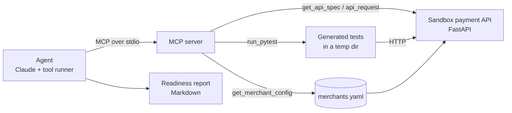

# Merchant Onboarding Agent

An agent that helps a payment platform's forward deployed engineer (FDE) get a new merchant
safely to go-live. Claude reads the payment API's spec, writes integration tests for the
merchant's configuration, runs them, investigates failures, and writes a readiness report.

**中文简介：** 一个帮支付平台 FDE 完成新商户接入的 Agent。Claude 读取支付 API 规范，针对商户配置生成并运行集成测试，排查失败原因，最后输出《上线就绪报告》。Agent 只能通过 MCP server 访问沙箱。

> Why this exists: see the [customer scenario](docs/scenario.md).

## Status

| Part | State |
|---|---|
| Mock payment API with per-merchant config | Done, tested |
| 10 seeded bugs, each switchable | Done, tested |
| MCP server (6 tools) | Done, tested end to end over stdio |
| Test agent (Claude or DeepSeek) | Written; tool loop tested against a scripted stand-in model. **Not yet run against a real model** (needs an API key) |
| Docker Compose | Written, **not yet verified** |
| Eval harness (recall / false positives) | [Built and self-tested](evals/README.md). **No model run yet, so no score** |

## Architecture



The MCP server is the only door. The agent cannot read the API's source, the bug
switches, or the answer key.

## The sandbox payment API

Merchants are tenants: one API, different rules per merchant ([config/merchants.yaml](config/merchants.yaml)).

| Merchant | Methods | Currencies | Max amount | Refunds |
|---|---|---|---|---|
| `acme_utilities` | card, bank_transfer | USD | 500000 | allowed |
| `nova_telecom` | card, wallet | USD, EUR | 100000 | **not allowed** |
| `old_gym` | card | USD | 20000 | (suspended merchant) |

Endpoints: create (authorize) → capture / void → refund, plus signed webhooks.
Ten numbered business rules (R1–R10) are published in the OpenAPI description:
merchant auth, payment-method and currency allowlists, amount limits, idempotency,
the payment state machine, capture and refund limits, isolation between merchants,
and webhook signatures.

Terms: **merchant** = the business being onboarded (the tenant). **Payer** = the person paying.

## Quick start

Needs Python 3.11+ and [uv](https://docs.astral.sh/uv/).

```bash
uv sync
uv run pytest                    # 32 tests
```

Start the sandbox (interactive docs at http://127.0.0.1:8000/docs):

```bash
uv run uvicorn onboarding.api.app:app_factory --factory --port 8000
```

In a second terminal, check the MCP wiring (no model call, no API key needed):

```bash
uv run python -m onboarding.agent.run --dry-run
```

Pick a model provider by setting its key. If `DEEPSEEK_API_KEY` is set the agent uses DeepSeek;
otherwise it uses Claude via `ANTHROPIC_API_KEY`.

| Provider | Key | Default model | Change it with |
|---|---|---|---|
| DeepSeek | `DEEPSEEK_API_KEY` | `deepseek-v4-pro` | `--model deepseek-flash` |
| Claude | `ANTHROPIC_API_KEY` | `claude-opus-5-5` | `--model ...` |

`--provider anthropic` (or `deepseek`) overrides the automatic choice.

Run the agent (this calls the model and costs tokens):

```bash
uv run python -m onboarding.agent.run --merchant nova_telecom
```

The report is printed and saved under `reports/`. Each defect is also filed with a regression test.

To give the agent something to find, start the sandbox with seeded bugs:

```bash
SEEDED_BUGS=B02,B08 uv run uvicorn onboarding.api.app:app_factory --factory --port 8000
```

### Eval

How many seeded bugs does the agent find, and how often is it wrong? Findings are graded by
replaying their regression tests on clean and buggy builds. Details: [evals/README.md](evals/README.md).

```bash
uv run python evals/run_eval.py --selftest
```

### With Docker

```bash
docker compose up api
docker compose run --rm agent --merchant nova_telecom
```

## MCP tools

| Tool | What it does |
|---|---|
| `get_api_spec` | OpenAPI spec, including business rules R1–R10 |
| `list_merchants` | Merchant ids and status |
| `get_merchant_config` | One merchant's sandbox configuration |
| `api_request` | One HTTP call to the sandbox, as a given merchant |
| `run_pytest` | Run a generated pytest file against the sandbox |
| `submit_finding` | File a confirmed defect with a regression test; rejected unless the test really fails |

## Safety choices

- **Sandbox only.** `api_request` refuses any path that leaves the sandbox host.
- **No real payment data.** Payers are opaque tokens. All secrets in the config are fakes.
- **Generated code is contained.** Tests run in a temp directory, with a timeout, and
  without the model API key. Use Docker so they run in a container, not on your machine.
- **A human decides.** The agent writes a report; it does not change configuration or approve go-live.

## Layout

```
config/merchants.yaml          per-merchant configuration
src/onboarding/api/            mock payment API + seeded bugs
src/onboarding/mcp_server/     MCP server
src/onboarding/agent/          the agent, with one backend per model provider
tests/                         rule checks, seeded-bug tests, MCP end-to-end test
evals/                         eval cases, grader, runner, answer key
docs/scenario.md               the customer scenario
```

## Roadmap

1. **First eval run** — get the baseline numbers, then tune the prompt against them
2. **Requirements → config** — turn a merchant's messy requirements doc into a config draft, and flag gaps
3. **Log diagnosis** — when a test fails, read service logs to find the root cause
